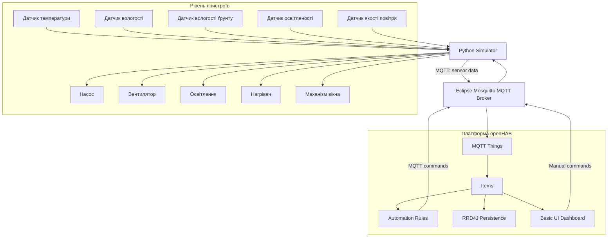

# Практична робота 8.1
# Smart Greenhouse — інтелектуальна система моніторингу та управління тепличним господарством

## 1. Загальна інформація про проєкт

**Назва проєкту:** Smart Greenhouse  
**Тип проєкту:** IoT-система моніторингу та автоматизації тепличного господарства.  
**Платформа автоматизації:** openHAB 4.3.5.  
**Протокол обміну даними:** MQTT.  
**MQTT-брокер:** Eclipse Mosquitto 2.1.2.  
**Мова програмування симулятора:** Python 3.11.  
**Інструмент моделювання пристроїв:** Python MQTT Simulator.

Smart Greenhouse — це концепція інтелектуальної системи для моніторингу параметрів мікроклімату теплиці та автоматизації роботи обладнання. Система отримує показники навколишнього середовища, передає їх через MQTT до платформи openHAB, відображає інформацію в користувацькому інтерфейсі та виконує автоматичні дії відповідно до встановлених умов.

У межах практичної роботи створено програмний прототип, який імітує роботу датчиків і виконавчих пристроїв та дозволяє продемонструвати основні функції майбутнього IoT-продукту без використання фізичного обладнання.

---

## 2. Ідея продукту та проблема, яку він вирішує

### 2.1. Опис проблеми

Під час вирощування рослин у теплицях необхідно постійно контролювати температуру повітря, вологість, стан ґрунту та рівень освітлення.

За відсутності автоматизованої системи власник теплиці або працівник повинен самостійно перевіряти показники, вмикати полив, регулювати вентиляцію та керувати освітленням.

Такий підхід має декілька недоліків:

- необхідність постійного ручного контролю;
- витрати часу на перевірку стану теплиці;
- ризик несвоєчасного реагування на зміну умов;
- можливість надмірного або недостатнього поливу;
- складність одночасного контролю декількох параметрів;
- відсутність централізованої історії вимірювань.

### 2.2. Запропоноване рішення

Smart Greenhouse вирішує ці проблеми шляхом використання IoT-технологій для збору, передавання, зберігання та обробки даних.

Система дозволяє:

1. Отримувати показники температури та вологості повітря.
2. Контролювати температуру та вологість ґрунту.
3. Відстежувати рівень освітленості.
4. Отримувати інформацію про якість повітря та модельований показник CO₂.
5. Автоматично керувати поливом, вентиляцією та освітленням.
6. Керувати обладнанням вручну через вебінтерфейс.
7. Переглядати історію вимірювань у вигляді графіків.

Основна мета продукту — зменшити необхідність постійного ручного контролю та створити централізовану систему управління умовами вирощування рослин.

---

## 3. Мінімально життєздатний продукт (MVP)

MVP (Minimum Viable Product) — це мінімальна версія продукту, яка містить основні функції, необхідні для перевірки його практичної цінності.

Для Smart Greenhouse визначено такі можливості MVP:

| № | Функція | Опис |
|---|---|---|
| 1 | Моніторинг температури повітря | Отримання поточного значення температури |
| 2 | Моніторинг вологості повітря | Відстеження рівня вологості |
| 3 | Моніторинг ґрунту | Контроль температури та вологості ґрунту |
| 4 | Контроль освітленості | Визначення рівня освітлення |
| 5 | Моніторинг якості повітря | Отримання модельованого показника CO₂ |
| 6 | Автоматичний полив | Увімкнення та вимкнення насоса залежно від вологості ґрунту |
| 7 | Автоматична вентиляція | Керування вентилятором залежно від температури |
| 8 | Автоматичне освітлення | Керування освітленням залежно від рівня освітленості |
| 9 | Ручне керування | Керування виконавчими пристроями через інтерфейс |
| 10 | Історія показників | Збереження та відображення історії вимірювань |

Реалізований прототип демонструє основні можливості MVP за допомогою програмного симулятора, MQTT та openHAB.

---

## 4. Product Requirements Document (PRD)

### 4.1. Цільова аудиторія

Основними користувачами Smart Greenhouse є:

| Категорія користувачів | Потреби |
|---|---|
| Власники приватних теплиць | Контроль умов вирощування та автоматизація догляду |
| Власники невеликих фермерських господарств | Зменшення ручної роботи та контроль параметрів |
| Сільськогосподарські підприємства | Централізований моніторинг тепличних приміщень |
| Працівники теплиць | Оперативне отримання інформації та керування обладнанням |
| Адміністратори систем | Налаштування обладнання та контроль працездатності |

### 4.2. Функціональні вимоги

| ID | Вимога | Опис |
|---|---|---|
| FR-01 | Збір температури повітря | Система повинна отримувати дані про температуру повітря |
| FR-02 | Збір вологості повітря | Система повинна отримувати показники вологості повітря |
| FR-03 | Моніторинг ґрунту | Система повинна контролювати температуру та вологість ґрунту |
| FR-04 | Контроль освітленості | Система повинна отримувати дані про рівень освітлення |
| FR-05 | Моніторинг якості повітря | Система повинна підтримувати отримання показників якості повітря та модельованого CO₂ |
| FR-06 | Автоматичний полив | Система повинна вмикати насос при вологості ґрунту нижче 35% та вимикати при вологості вище 60% |
| FR-07 | Автоматична вентиляція | Система повинна вмикати вентилятор при температурі вище 30 °C та вимикати нижче 26 °C |
| FR-08 | Автоматичне освітлення | Система повинна вмикати освітлення при освітленості нижче 3000 lx та вимикати вище 7000 lx |
| FR-09 | Ручне керування | Користувач повинен мати можливість вручну керувати обладнанням |
| FR-10 | Відображення даних | Система повинна відображати поточні показники у вебінтерфейсі |
| FR-11 | Збереження історії | Система повинна зберігати історичні значення показників для подальшого перегляду |

### 4.3. Нефункціональні вимоги

| ID | Вимога | Опис |
|---|---|---|
| NFR-01 | Продуктивність | Система повинна забезпечувати регулярне отримання та обробку показників |
| NFR-02 | Надійність | Система повинна коректно обробляти повідомлення MQTT та підтримувати відновлення з'єднання |
| NFR-03 | Масштабованість | Архітектура повинна дозволяти додавання нових датчиків та виконавчих пристроїв |
| NFR-04 | Зручність використання | Інтерфейс повинен забезпечувати зрозуміле відображення показників і засобів керування |
| NFR-05 | Сумісність | Система повинна підтримувати взаємодію пристроїв через MQTT |
| NFR-06 | Безперервність роботи | Система повинна підтримувати постійний моніторинг та відновлення після тимчасових збоїв |
| NFR-07 | Безпека | Доступ до MQTT-брокера повинен контролюватися за допомогою автентифікації та ACL |

### 4.4. Сценарії використання (Use Cases)

**UC-01. Перегляд температури повітря**

1. Користувач відкриває вебінтерфейс Smart Greenhouse.
2. Система отримує поточне значення температури через MQTT.
3. OpenHAB відображає значення температури.
4. Користувач переглядає поточний стан мікроклімату.

**UC-02. Контроль вологості ґрунту**

1. Датчик або симулятор передає показник вологості ґрунту.
2. OpenHAB отримує значення.
3. Система перевіряє його відповідність встановленим порогам.
4. За необхідності запускається автоматичний полив.

**UC-03. Автоматичне керування насосом**

1. Вологість ґрунту опускається нижче 35%.
2. Правило автоматизації надсилає команду ON.
3. MQTT-брокер передає команду симулятору.
4. Симулятор вмикає насос.
5. Після перевищення вологості 60% система надсилає команду OFF.

**UC-04. Автоматична вентиляція**

1. Система отримує температуру повітря.
2. Якщо температура перевищує 30 °C, надсилається команда ввімкнення вентилятора.
3. Якщо температура стає нижчою за 26 °C, вентилятор вимикається.

**UC-05. Автоматичне освітлення**

1. Система отримує значення освітленості.
2. Якщо освітленість нижча за 3000 lx, система вмикає освітлення.
3. Якщо освітленість перевищує 7000 lx, система вимикає освітлення.

**UC-06. Ручне керування обладнанням**

1. Користувач відкриває розділ керування.
2. Обирає необхідний пристрій.
3. Надсилає команду через інтерфейс.
4. Команда передається через MQTT.
5. Симулятор змінює стан відповідного виконавчого пристрою.

**UC-07. Перегляд історії вимірювань**

1. Користувач відкриває розділ історії показників.
2. Система отримує збережені дані з RRD4J.
3. Basic UI відображає графіки.
4. Користувач аналізує зміни параметрів у часі.

---

## 5. Архітектура системи

### 5.1. Загальна структура

Архітектура Smart Greenhouse побудована за принципом взаємодії IoT-пристроїв через MQTT-брокер із централізованою платформою автоматизації openHAB.

Основні компоненти:

- **Датчики:** джерела даних про стан тепличного середовища.
- **Виконавчі пристрої:** насос, вентилятор, освітлення, нагрівач та механізм вікна.
- **Python Simulator:** програмна модель датчиків та обладнання.
- **Mosquitto:** MQTT-брокер для обміну повідомленнями.
- **openHAB:** платформа отримання, обробки та відображення даних.
- **Rules Engine:** виконання автоматичних сценаріїв.
- **RRD4J:** збереження історії числових показників.
- **Basic UI:** користувацький вебінтерфейс.

### 5.2. Архітектурна діаграма



У межах поточного прототипу фізичні датчики та виконавчі пристрої представлені програмним симулятором. Діаграма показує логічну структуру майбутньої системи.

### 5.3. Принцип роботи

1. Python Simulator генерує значення показників тепличного середовища.
2. Дані публікуються в MQTT-топіки.
3. Mosquitto приймає повідомлення та передає їх підписаним клієнтам.
4. OpenHAB отримує повідомлення через MQTT Binding.
5. Значення записуються у відповідні Items.
6. Правила автоматизації аналізують отримані значення.
7. RRD4J зберігає історичні вимірювання.
8. Basic UI відображає поточний стан системи та графіки.
9. Команди ручного або автоматичного керування передаються через MQTT назад до симулятора.

---

## 6. Модель даних

### 6.1. Параметри, які збираються

| Параметр | MQTT-топік | Тип даних | Одиниця вимірювання |
|---|---|---|---|
| Температура повітря | `greenhouse/sensors/air_temp` | Числовий | °C |
| Вологість повітря | `greenhouse/sensors/air_humidity` | Числовий | % |
| Температура ґрунту | `greenhouse/sensors/soil_temp` | Числовий | °C |
| Вологість ґрунту | `greenhouse/sensors/soil_humidity` | Числовий | % |
| Освітленість | `greenhouse/sensors/lux` | Числовий | lx |
| CO₂ | `greenhouse/sensors/co2` | Числовий | ppm (модельоване значення) |
| Стан системи | `greenhouse/system/status` | Текстовий | ONLINE/OFFLINE |

### 6.2. Дані виконавчих пристроїв

| Пристрій | MQTT-топік | Тип даних |
|---|---|---|
| Насос | `greenhouse/actuators/pump` | ON/OFF |
| Вентилятор | `greenhouse/actuators/fan` | ON/OFF |
| Освітлення | `greenhouse/actuators/light` | ON/OFF |
| Нагрівач | `greenhouse/actuators/heater` | ON/OFF |
| Вікно | `greenhouse/actuators/window` | Числовий, 0–100 |

### 6.3. Частота передавання

Симулятор передає показники датчиків кожні **3 секунди**.

Для передавання використовується MQTT. Кожен параметр публікується в окремий топік, а значення передаються як прості числові текстові повідомлення.

Приклад:

```text
Topic: greenhouse/sensors/air_temp
Payload: 24.5
```

Приклад вологості ґрунту:

```text
Topic: greenhouse/sensors/soil_humidity
Payload: 55.0
```

Стан системи передається через:

```text
Topic: greenhouse/system/status
Payload: ONLINE
```

Симулятор також передає повідомлення про OFFLINE під час коректного завершення роботи.

**Примітка:** у поточній реалізації використовуються окремі MQTT-повідомлення з числовими значеннями, а не єдиний JSON-об'єкт. JSON може бути використаний у майбутніх версіях для розширення моделі даних.

### 6.4. Збереження історії

Для збереження числових показників використовується RRD4J Persistence.

Зберігаються такі Items:

- `Greenhouse_AirTemperature`
- `Greenhouse_AirHumidity`
- `Greenhouse_SoilTemperature`
- `Greenhouse_SoilHumidity`
- `Greenhouse_Illumination`
- `Greenhouse_CO2`

Використовуються дві стратегії:

- `everyChange` — запис значень при зміні стану;
- `everyMinute` — періодичне збереження щохвилини.

Історичні дані відображаються в Basic UI за допомогою графіків за останню добу.

---

## 7. Реалізація прототипу

### 7.1. Використані технології

| Технологія | Призначення |
|---|---|
| Python 3.11 | Створення симулятора пристроїв |
| Paho MQTT | MQTT-клієнт для Python |
| Eclipse Mosquitto 2.1.2 | MQTT-брокер |
| openHAB 4.3.5 | Платформа автоматизації |
| MQTT Binding | Підключення openHAB до брокера |
| RRD4J | Збереження історії вимірювань |
| Docker | Ізольований запуск компонентів |
| Basic UI | Вебінтерфейс системи |

### 7.2. MQTT-брокер

Для обміну повідомленнями використовується окремий екземпляр Eclipse Mosquitto.

Брокер працює в Docker та використовує:

- автентифікацію клієнтів;
- окремого користувача для Smart Greenhouse;
- ACL для обмеження доступу до топіків `greenhouse/#`;
- MQTT-порт 1884 на локальному комп'ютері.

Для підключення OpenHAB використовується мережевий alias `pr8-mosquitto`.

### 7.3. Програмний симулятор

Python Simulator моделює поведінку датчиків та виконавчих пристроїв.

Основні можливості:

- генерація показників мікроклімату;
- передавання даних через MQTT кожні 3 секунди;
- підписка на команди виконавчих пристроїв;
- імітація зміни показників залежно від роботи обладнання;
- передавання стану ONLINE/OFFLINE.

Наприклад, під час увімкнення насоса симулятор збільшує вологість ґрунту, а під час роботи вентилятора знижує температуру повітря.

Таким чином, можна спостерігати взаємозв'язок між командами керування та показниками середовища.

### 7.4. Підключення до openHAB

У конфігурації openHAB створено окремі файли Smart Greenhouse:

- `things/greenhouse.things`
- `items/greenhouse.items`
- `sitemaps/greenhouse.sitemap`
- `rules/greenhouse.rules`
- `persistence/rrd4j.persist`

Файли дозволяють відокремити конфігурацію Smart Greenhouse від інших проєктів, які використовуються в тому самому середовищі openHAB.

### 7.5. Автоматизація

У системі реалізовано три основні групи автоматичних правил.

**Автоматичний полив**

| Умова | Дія |
|---|---|
| Вологість ґрунту нижче 35% | Увімкнути насос |
| Вологість ґрунту вище 60% | Вимкнути насос |

**Автоматична вентиляція**

| Умова | Дія |
|---|---|
| Температура повітря вище 30 °C | Увімкнути вентилятор |
| Температура повітря нижче 26 °C | Вимкнути вентилятор |

**Автоматичне освітлення**

| Умова | Дія |
|---|---|
| Освітленість нижче 3000 lx | Увімкнути освітлення |
| Освітленість вище 7000 lx | Вимкнути освітлення |

Різні пороги ввімкнення та вимкнення дозволяють уникнути надто частого перемикання обладнання при коливанні показників поблизу одного значення.

### 7.6. Користувацький інтерфейс

Для керування системою створено sitemap `greenhouse.sitemap`.

Він містить такі розділи:

1. **Стан системи** — відображення статусу підключення.
2. **Моніторинг мікроклімату** — поточні значення всіх шести параметрів.
3. **Історія показників** — графіки температури повітря, вологості повітря, температури ґрунту, вологості ґрунту, освітленості та CO₂.
4. **Керування обладнанням** — перемикачі насоса, вентилятора, освітлення та нагрівача, а також регулятор положення вікна.

---

## 8. Тестування прототипу

Після налаштування системи було виконано перевірку основних компонентів.

| № | Тест | Очікуваний результат | Результат |
|---|---|---|---|
| 1 | Підключення MQTT-брокера | Успішне підключення клієнта | PASS |
| 2 | MQTT-автентифікація | Підключення з правильними обліковими даними | PASS |
| 3 | Передавання показників | Отримання повідомлень від симулятора | PASS |
| 4 | Відображення температури повітря | Показ поточного значення в openHAB | PASS |
| 5 | Відображення вологості повітря | Показ поточного значення в openHAB | PASS |
| 6 | Відображення параметрів ґрунту | Показ температури та вологості | PASS |
| 7 | Відображення освітленості та CO₂ | Показ відповідних значень | PASS |
| 8 | Ручне керування насосом | Передавання команди до симулятора | PASS |
| 9 | Ручне керування вентилятором | Передавання команди до симулятора | PASS |
| 10 | Ручне керування освітленням | Передавання команди до симулятора | PASS |
| 11 | Ручне керування нагрівачем | Передавання команди до симулятора | PASS |
| 12 | Керування положенням вікна | Передавання числових команд | PASS |
| 13 | Автоматичне ввімкнення поливу | Насос вмикається при вологості нижче 35% | PASS |
| 14 | Автоматичне вимкнення поливу | Насос вимикається при вологості вище 60% | PASS |
| 15 | Збереження історії | Отримання історичних значень через RRD4J API | PASS |
| 16 | Відображення графіків | Відображення історії в Basic UI | PASS |

Правила автоматичної вентиляції та освітлення також налаштовані в `greenhouse.rules`, але їх окреме спрацювання не було зафіксоване під час практичного тестування.

### 8.1. Перевірка збереження даних

Для перевірки RRD4J використано OpenHAB API Explorer.

Було виконано запит:

```text
GET /rest/persistence/items/Greenhouse_AirTemperature?serviceId=rrd4j
```

Сервер повернув відповідь `200 OK` та 63 точки даних для температури повітря.

Після цього було додано параметр `service="rrd4j"` до графіків sitemap. У результаті історичні значення почали відображатися в Basic UI.

### 8.2. Результати

Під час тестування підтверджено:

- працездатність MQTT-брокера;
- передавання показників симулятором;
- отримання даних платформою openHAB;
- ручне керування всіма передбаченими виконавчими пристроями;
- автоматичне ввімкнення та вимкнення насоса;
- збереження історичних показників;
- відображення графіків у вебінтерфейсі.

---

## 9. Економічне обґрунтування

### 9.1. Орієнтовна вартість обладнання

Для оцінки вартості майбутньої фізичної реалізації використано орієнтовні ціни компонентів.

| Компонент | Кількість | Ціна, грн | Сума, грн |
|---|---:|---:|---:|
| ESP32 | 1 | 300 | 300 |
| DHT22 | 1 | 150 | 150 |
| Датчик вологості ґрунту | 1 | 100 | 100 |
| BH1750 | 1 | 100 | 100 |
| MQ-135 | 1 | 180 | 180 |
| Релейний модуль | 1 | 150 | 150 |
| Водяний насос | 1 | 250 | 250 |
| Вентилятор | 1 | 250 | 250 |
| Фітолампа | 1 | 600 | 600 |
| Блок живлення | 1 | 300 | 300 |
| Кабелі та корпуси | 1 комплект | 500 | 500 |
| **Разом** | | | **2880** |

Зазначені ціни є розрахунковими припущеннями для навчального економічного обґрунтування, а не перевіреними актуальними пропозиціями постачальників.

### 9.2. Витрати на розробку

Для оцінки трудових витрат прийнято такі припущення:

- тривалість розробки — 40 годин;
- умовна вартість однієї години роботи — 200 грн.

Розрахунок:

40 × 200 = 8000 грн.

### 9.3. Витрати на підтримку

Для обслуговування системи прийнято орієнтовну суму 400 грн на місяць.

Ці витрати можуть включати перевірку обладнання, заміну несправних компонентів та підтримку працездатності програмного забезпечення.

### 9.4. Очікувана економія

Для оцінки потенційної економії часу прийнято такі припущення:

- система дозволяє заощаджувати 15 хвилин ручної роботи щодня;
- умовна вартість години роботи становить 100 грн;
- розрахунок виконується за 30 днів.

Розрахунок:

15 / 60 × 100 × 30 = 750 грн на місяць.

### 9.5. Розрахунок окупності

| Показник | Значення |
|---|---:|
| Вартість обладнання | 2880 грн |
| Вартість розробки | 8000 грн |
| Початкові інвестиції | 10880 грн |
| Очікувана економія на місяць | 750 грн |
| Витрати на підтримку на місяць | 400 грн |
| Чистий місячний ефект | 350 грн |

Окупність повних початкових інвестицій:

10880 / 350 ≈ 31,1 місяця.

Окупність лише обладнання:

2880 / 350 ≈ 8,2 місяця.

Таким чином, за прийнятих припущень повна окупність системи становить приблизно 31 місяць.

Реальний економічний ефект залежатиме від площі теплиці, кількості обладнання, вартості робочого часу, витрат води та електроенергії, а також інтенсивності використання системи.

---

## 10. Обмеження поточного прототипу

Поточна версія Smart Greenhouse є програмним прототипом, тому має певні обмеження:

1. Замість фізичних датчиків використовуються програмно згенеровані значення.
2. Замість реальних виконавчих механізмів використовуються програмні моделі пристроїв.
3. Значення CO₂ є модельованим показником, а не результатом вимірювання каліброваним датчиком CO₂.
4. MQ-135 може використовуватися для оцінювання якості повітря, але не є точним вимірювачем концентрації CO₂ без відповідного калібрування та обробки.
5. У поточній версії не реалізовано окремий механізм підтвердження фактичного стану кожного фізичного виконавчого пристрою.
6. Економічні розрахунки побудовані на умовних припущеннях.
7. Для використання в реальній теплиці необхідно додатково перевірити електричну безпеку, захист від вологи та надійність обладнання.

---

## 11. Подальший розвиток продукту (Roadmap)

Можливі напрямки розвитку Smart Greenhouse:

| Етап | Заплановане вдосконалення |
|---|---|
| 1 | Підключення фізичного контролера ESP32 |
| 2 | Інтеграція реальних датчиків температури та вологості |
| 3 | Підключення фізичного датчика вологості ґрунту |
| 4 | Використання реального датчика CO₂ |
| 5 | Додавання сповіщень про критичні значення |
| 6 | Розширення історії вимірювань та аналітики |
| 7 | Додавання статистики витрат води та електроенергії |
| 8 | Розробка мобільного інтерфейсу |
| 9 | Розширення системи для декількох тепличних приміщень |

Розвиток продукту дозволить перейти від програмного прототипу до повноцінної фізичної IoT-системи.

---

## 12. План відеопрезентації

Для захисту практичної роботи передбачено відеопрезентацію тривалістю 5–7 хвилин.

| Час | Зміст |
|---|---|
| 0:00–0:40 | Представлення проєкту та проблеми ручного контролю теплиці |
| 0:40–1:20 | Ідея Smart Greenhouse та основні можливості MVP |
| 1:20–2:10 | Демонстрація архітектури системи та використаних технологій |
| 2:10–3:20 | Демонстрація симулятора, MQTT та отримання показників в openHAB |
| 3:20–4:20 | Демонстрація ручного керування обладнанням |
| 4:20–5:10 | Демонстрація автоматичного поливу та правил автоматизації |
| 5:10–5:50 | Демонстрація графіків та історії вимірювань |
| 5:50–6:30 | Економічне обґрунтування та подальший розвиток продукту |

Під час демонстрації доцільно показати:

- Python Simulator із повідомленнями MQTT;
- MQTT-брокер Mosquitto;
- статус підключення пристроїв в openHAB;
- поточні значення датчиків;
- ручне керування насосом, вентилятором та освітленням;
- автоматичне ввімкнення та вимкнення поливу;
- графіки історії показників.

---

## 13. Висновок

У результаті виконання практичної роботи 8.1 було розроблено концепцію IoT-продукту Smart Greenhouse — інтелектуальної системи моніторингу та управління тепличним господарством.

Було визначено проблему, цільову аудиторію, основні можливості MVP, функціональні та нефункціональні вимоги, сценарії використання, архітектуру системи, модель даних та економічну доцільність продукту.

Практично реалізовано програмний прототип на основі Python, MQTT, Eclipse Mosquitto та openHAB. Створено симулятор датчиків і виконавчих пристроїв, налаштовано передавання даних, ручне керування обладнанням, правила автоматизації та збереження історичних показників через RRD4J.

Під час тестування підтверджено роботу MQTT-з'єднання, отримання показників, ручне керування обладнанням, автоматичне ввімкнення та вимкнення поливу, збереження історії та відображення графіків.

Отже, створений прототип демонструє основні принципи роботи інтелектуальної IoT-системи для тепличного господарства та може бути використаний як основа для подальшої реалізації продукту з фізичними датчиками й виконавчими пристроями.

---

## 14. Декларація про використання штучного інтелекту

Під час виконання практичної роботи використовувався ChatGPT як допоміжний інструмент для структурування та оформлення документації.

Штучний інтелект застосовувався для допомоги у формулюванні опису продукту, систематизації функціональних і нефункціональних вимог, оформленні таблиць, архітектурної діаграми, економічного обґрунтування та структури README.md.

Основні технічні рішення, налаштування середовища, створення конфігураційних файлів, запуск симулятора та перевірка працездатності прототипу виконувалися автором роботи.

Згенеровані текстові матеріали були перевірені та адаптовані відповідно до фактично реалізованого проєкту.

**Інструмент:** ChatGPT.  
**Мета використання:** допомога в оформленні та структуруванні текстової документації.  
**Використаний результат:** підготовлені й відредаговані текстові описи, таблиці та Mermaid-діаграма.