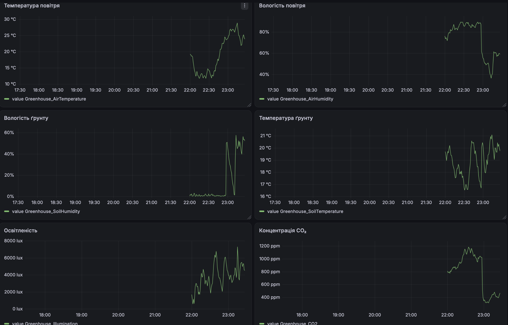
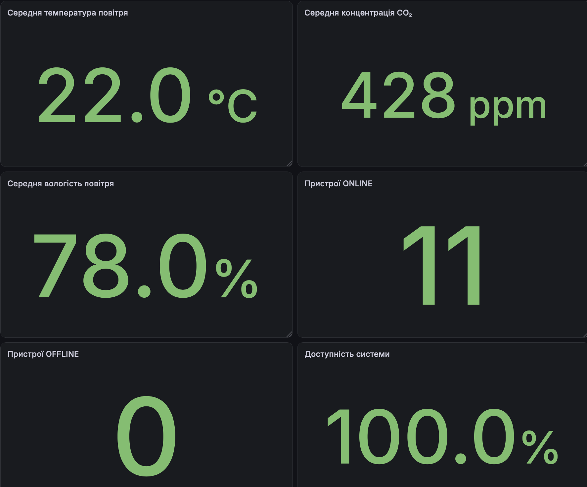
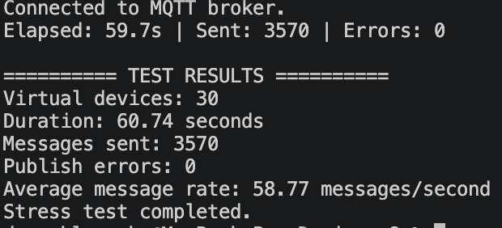
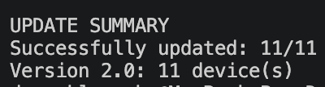
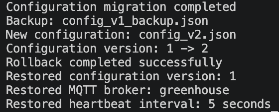

# Практична робота 8.2
## Тестування та життєвий цикл IoT-продукту Smart Greenhouse

## 1. Мета роботи

Метою практичної роботи є тестування IoT-системи Smart Greenhouse, перевірка взаємодії її компонентів, моніторинг стану пристроїв, виявлення аномалій, оцінювання продуктивності, моделювання відмов і відновлення, створення інформаційної панелі та планування подальшого розвитку системи.

## 2. Опис системи

Smart Greenhouse — це система моніторингу та автоматизованого керування тепличним господарством. Вона використовує MQTT для обміну повідомленнями, openHAB для обробки даних і керування пристроями, InfluxDB для зберігання часових рядів та Grafana для візуалізації показників.

У межах роботи використовуються 11 логічних віртуальних пристроїв:

| № | Ідентифікатор | Призначення |
|---|---|---|
| 1 | air_temp | Температура повітря |
| 2 | air_humidity | Вологість повітря |
| 3 | soil_temp | Температура ґрунту |
| 4 | soil_humidity | Вологість ґрунту |
| 5 | lux | Освітленість |
| 6 | co2 | Концентрація CO₂ |
| 7 | pump | Керування насосом |
| 8 | fan | Керування вентилятором |
| 9 | light | Керування освітленням |
| 10 | heater | Керування обігрівачем |
| 11 | window | Керування вікном |

Віртуальні пристрої представлені логічними сутностями в симуляторі, а не окремими фізичними ESP32.

## 3. Функціональне тестування

Було перевірено передавання показників датчиків, роботу виконавчих пристроїв, автоматизацію та обробку граничних значень.

Основні сценарії автоматизації:

- Увімкнення поливу, якщо вологість ґрунту нижча за 35%, та вимкнення після перевищення 60%.
- Увімкнення вентиляції за температури повітря вище 30 °C та вимкнення за температури нижче 26 °C.
- Увімкнення освітлення за освітленості нижче 3000 lx та вимкнення після перевищення 7000 lx.

### 3.1. Перевірка граничних значень

Для перевірки обробки некоректних показників використовувалися такі діапазони:

| Показник | Допустимий діапазон |
|---|---|
| Температура повітря | 10–45 °C |
| Вологість повітря | 20–90 % |
| Температура ґрунту | 10–35 °C |
| Вологість ґрунту | 0–100 % |
| Освітленість | 0–20000 lx |
| CO₂ | 300–1500 ppm |

Було перевірено некоректні значення: 50 °C для температури повітря, 95% для вологості повітря, 50 °C для температури ґрунту, 110% для вологості ґрунту, 25000 lx для освітленості та 2000 ppm для CO₂.

У кожному випадку openHAB зафіксував відповідне попередження про недопустиме значення.

### 3.2. Виявлення різких змін

Було перевірено виявлення раптових змін показників датчиків. Зокрема, тестувалося різке збільшення температури повітря з 22,1 °C до 40 °C. Система зафіксувала попередження про аномальну зміну.

Також перевірялася реакція на різкі зміни вологості та інших показників.

## 4. Моніторинг стану пристроїв

Для кожного з 11 пристроїв реалізовано моніторинг стану за допомогою heartbeat-повідомлень.

Основні параметри:
- Інтервал надсилання heartbeat — 5 секунд.
- Час очікування без heartbeat — 15 секунд.
- Стани пристроїв — ONLINE та OFFLINE.
- Фіксація часу останнього повідомлення — Last Seen.

### 4.1. Перевірка відмови та відновлення

Під час тестування симулятор було зупинено. Після закінчення 15 секунд усі 11 пристроїв перейшли у стан OFFLINE.

Після повторного запуску симулятора всі пристрої повернулися до стану ONLINE.

Таким чином, було перевірено виявлення втрати зв'язку та відновлення роботи пристроїв.

## 5. Інтеграційне тестування

Було перевірено взаємодію основних компонентів системи:

- MQTT-брокер приймає повідомлення від симулятора.
- openHAB отримує та обробляє показники датчиків.
- Правила автоматизації реагують на зміну показників.
- Система моніторингу оновлює стани пристроїв.
- InfluxDB зберігає історичні значення.
- Grafana відображає отримані дані.

Також перевірено втрату з'єднання з MQTT-брокером та подальше відновлення передавання повідомлень.

## 6. Стрес-тестування

Для перевірки продуктивності було створено окремий скрипт `stress_test.py`, який імітує роботу 30 віртуальних пристроїв.

Параметри тесту:
- Кількість пристроїв — 30.
- Інтервал оновлення — 0,5 секунди.
- Тривалість — 60 секунд.
- Формат повідомлень — JSON.
- MQTT QoS — 0.

Результати:

| Показник | Результат |
|---|---:|
| Кількість пристроїв | 30 |
| Тривалість тесту | 60,73 с |
| Кількість повідомлень | 3570 |
| Помилки публікації | 0 |
| Середня швидкість | 58,78 повідомлень/с |
| Items, які отримали дані в openHAB | 30 із 30 |

Під час тесту всі 30 відповідних Items в openHAB отримали JSON-дані.

Після тестування зафіксовано такі показники контейнера openHAB:
- CPU — 0,45%.
- Використання оперативної пам'яті — 898,2 MiB.
- Загальний обсяг доступної пам'яті — приблизно 7,748 GiB.

У межах проведеного тесту система успішно обробила потік повідомлень від 30 віртуальних пристроїв.

## 7. Сповіщення адміністратора

Для надсилання повідомлень адміністратору було налаштовано Telegram Bot через Telegram Binding в openHAB.

Перевірено:
- тестове надсилання повідомлення;
- сповіщення про перехід пристроїв у стан OFFLINE;
- сповіщення про відновлення пристроїв.

Під час перевірки переходу в OFFLINE було отримано повідомлення для всіх 11 пристроїв.

Під час перевірки відновлення не всі повідомлення про перехід у ONLINE надійшли. Це обмеження зафіксовано для подальшого виправлення.

## 8. Тестування зручності використання

Для демонстрації оцінювання зручності використання було сформовано модельний набір відповідей п'яти умовних користувачів.

**Важливо:** наведені результати є змодельованими для оформлення практичної роботи та не є відповідями реальних опитаних користувачів.

| Критерій | Середня оцінка |
|---|---:|
| Зрозумілість інтерфейсу | 4,4/5 |
| Пошук показників датчиків | 4,6/5 |
| Зрозумілість статусів ONLINE/OFFLINE | 4,4/5 |
| Зручність керування пристроями | 4,0/5 |
| Достатність інформації | 4,0/5 |

Загальна середня оцінка — 4,28/5.

У модельних відгуках позитивно оцінено зрозумілість інтерфейсу та доступність показників. Серед можливих покращень визначено додавання графіків тенденцій, зрозуміліших підписів елементів керування та помітніших критичних сповіщень.

## 9. Інформаційна панель Grafana

Для візуалізації даних створено інформаційну панель Grafana з підключенням до InfluxDB.

Панель містить шість графіків:
1. Температура повітря.
2. Вологість повітря.
3. Вологість ґрунту.
4. Температура ґрунту.
5. Освітленість.
6. Концентрація CO₂.

Також створено KPI-показники:
- середня температура повітря;
- середня вологість повітря;
- середня концентрація CO₂;
- кількість пристроїв ONLINE;
- кількість пристроїв OFFLINE;
- доступність системи у відсотках.

Для KPI налаштовано кольорові пороги, які допомагають візуально оцінювати стан системи.

Під час перевірки відмови панель показала 0 пристроїв ONLINE, 11 OFFLINE та 0% доступності. Після відновлення симулятора показники повернулися до 11 ONLINE, 0 OFFLINE та 100% доступності.

## 10. Моделювання OTA-оновлення

Для демонстрації життєвого циклу прошивки створено окремий каталог `ota`.

Підготовлено два маніфести:
- v1.0 — початкова версія;
- v2.0 — оновлена версія з додатковими можливостями моніторингу, виявлення аномалій, обробки помилок та підтримки OTA.

### 10.1. Поетапне розгортання

У файлі `devices.json` визначено 11 віртуальних пристроїв із початковою версією 1.0.

Скрипт `ota_simulator.py` виконав:
1. Пілотне оновлення одного пристрою.
2. Перевірку та застосування нової версії.
3. Пакетне оновлення решти десяти пристроїв.

Результат: успішно оновлено 11 із 11 пристроїв до версії 2.0.

### 10.2. Міграція конфігурації

Скрипт `migration.py` моделює перехід конфігурації з версії 1 до версії 2.

Під час міграції:
- збережено початкові параметри MQTT;
- додано перевірку стану пристроїв;
- додано тайм-аут OFFLINE;
- додано виявлення аномалій;
- додано параметри OTA;
- створено резервну копію початкової конфігурації.

Результат: конфігурацію успішно переведено з версії 1 до версії 2.

### 10.3. Відкат до попередньої версії

Скрипт `rollback.py` використано для перевірки відновлення початкової конфігурації з резервної копії.

Результат: успішно відновлено конфігурацію версії 1, включно з параметрами MQTT та інтервалом heartbeat 5 секунд.

**Примітка:** OTA-оновлення, міграція та відкат є програмною симуляцією на JSON-файлах. Реальне перепрошивання фізичних ESP32 у межах цієї роботи не виконувалося.

## 11. Шестимісячна дорожня карта

| Місяць | Напрям розвитку | Основні завдання |
|---|---|---|
| 1 | Оптимізація моніторингу | Покращення Grafana, моніторингу стану пристроїв та надійності сповіщень |
| 2 | Удосконалення автоматизації | Оптимізація поливу, вентиляції, освітлення та порогових значень |
| 3 | Безпека | Покращення MQTT-автентифікації, контролю доступу та захисту облікових даних |
| 4 | OTA | Перевірка цілісності прошивки, поетапне розгортання та автоматичний відкат |
| 5 | Аналітика | Розширення Grafana, аналіз історичних даних і тенденцій |
| 6 | Підготовка до розгортання | Комплексне тестування, оптимізація продуктивності та підготовка до пілотного використання |

## 12. Структура проєкту

```text
pr8/
├── README.md
├── README1.md
├── mosquitto/
│   └── config/
│       ├── acl
│       └── mosquitto.conf
├── simulator/
│   ├── esp32_simulator.py
│   └── stress_test.py
├── screenshots/
│   ├── grafana_dashboard.png
│   ├── grafana_dashboard1.png
│   ├── stress_test.png
│   ├── ota_update.png
│   ├── ota_migration_rollback.png
│   └── device_monitoring.png
└── ota/
    ├── firmware/
    │   ├── v1.0/
    │   │   └── manifest.json
    │   └── v2.0/
    │       └── manifest.json
    ├── devices.json
    ├── config_v1.json
    ├── config_v1_backup.json
    ├── config_v2.json
    ├── config_rollback.json
    ├── ota_simulator.py
    ├── migration.py
    ├── rollback.py
    └── roadmap.md
```

## 13. Скріншоти виконання роботи

### 13.1. Інформаційна панель Grafana

На рисунку представлено інформаційну панель Smart Greenhouse з графіками показників датчиків та основними KPI системи.





### 13.2. Результати стрес-тестування

На рисунку представлено результати стрес-тестування системи Smart Greenhouse. Під час тесту моделювалася робота 30 віртуальних пристроїв з інтервалом оновлення 0,5 секунди протягом приблизно 60 секунд.

За результатами тестування було надіслано 3570 повідомлень, помилок публікації не зафіксовано. Середня швидкість передавання становила 58,77 повідомлення за секунду. Тест завершився успішно.



### 13.3. Результати OTA-оновлення

На рисунку представлено результати моделювання OTA-оновлення Smart Greenhouse з версії прошивки 1.0 до версії 2.0.

Спочатку було виконано пілотне оновлення одного пристрою, після чого проведено пакетне оновлення решти пристроїв. У результаті всі 11 віртуальних пристроїв успішно перейшли на версію 2.0.



### 13.4. Міграція конфігурації та відкат

На рисунку продемонстровано результати міграції конфігурації Smart Greenhouse з версії 1 до версії 2 та подальшого відкату.

Під час міграції було збережено початкові параметри MQTT, додано нові параметри моніторингу й OTA, а також створено резервну копію конфігурації.

Під час перевірки механізму rollback успішно відновлено початкову конфігурацію версії 1, включно з параметрами MQTT та інтервалом heartbeat 5 секунд.



### 13.5. Моніторинг стану пристроїв

На рисунку представлено моніторинг стану віртуальних пристроїв Smart Greenhouse в openHAB. Для кожного пристрою відображається поточний стан ONLINE або OFFLINE та інформація про останню активність.

Під час тестування було перевірено перехід усіх 11 пристроїв у стан OFFLINE після зупинки симулятора та їх повернення до стану ONLINE після відновлення роботи.


## 14. Висновки

У ході практичної роботи було проведено функціональне та інтеграційне тестування IoT-системи Smart Greenhouse, перевірено обробку граничних значень і виявлення аномалій.

Реалізовано моніторинг стану 11 логічних пристроїв за допомогою heartbeat-повідомлень, перевірено виявлення втрати зв'язку та відновлення роботи.

Проведено стрес-тестування з 30 віртуальними пристроями, під час якого було передано 3570 повідомлень без помилок публікації. Створено інформаційну панель Grafana для відображення показників датчиків та KPI системи.

Налаштовано Telegram-сповіщення про відмови пристроїв. Водночас під час перевірки відновлення було виявлено неповне надходження повідомлень ONLINE, що потребує подальшого вдосконалення.

Окремо змодельовано OTA-оновлення з версії 1.0 до 2.0, міграцію конфігурації, резервне копіювання та відкат до попередньої версії.

За результатами роботи сформовано шестимісячну дорожню карту подальшого розвитку Smart Greenhouse.

## 15. Декларація використання штучного інтелекту

Під час виконання практичної роботи використовувався ChatGPT.

Штучний інтелект застосовувався для допомоги з поясненням окремих етапів роботи, підготовкою та оформленням текстових описів, таблиць, документації, а також прикладів команд і програмних скриптів.

Згенеровані матеріали перевірялися шляхом виконання команд, запуску скриптів і тестування компонентів системи. Остаточні результати та висновки сформовано на основі фактично отриманих результатів роботи.